<h1 align="center">LLM Eval Action</h1>

<p align="center">
  <em>A GitHub Action that gates pull requests on statistically tested LLM evaluation regressions.</em>
</p>

<p align="center">
  <a href="https://github.com/adeoluo/llm-eval-action/actions/workflows/ci.yml"></a>
  <a href="https://github.com/adeoluo/llm-eval-action/releases"></a>
  
  <a href="LICENSE"></a>
</p>

---

## Motivation

A change to a prompt, a model version, or a retrieval step moves evaluation scores by a
point or two, and so does rerunning the same system on a different sample. A gate that
fails on any drop below the baseline fails about half of all unchanged pull requests (see
[Results](#results)); a gate with a loose fixed threshold misses real regressions
on small eval sets. Treating the comparison as a paired experiment fixes both: the same
examples are scored twice, so the per-example differences carry far less noise than two
independent accuracy numbers, and a significance test decides whether the drop is larger
than that noise.

`llm-eval-action` compares the per-example evaluation results of a pull request against a
baseline run and fails the check when a metric regresses. It pairs examples by id, runs
the appropriate paired significance test for each metric, and writes a pass/fail report to
the job summary, so a reviewer sees the size of the change, its uncertainty, and the
examples that got worse without leaving the pull request.

## Architecture

<p align="center">
  
</p>

<sub>Legend: amber = entry points and external systems, indigo = core logic, green = data and state, blue = validation and control, grey = observability and outputs.</sub>

A workflow step passes its inputs through `runtime.ts` to `run()`, which validates them,
optionally downloads the baseline artifact, parses both result files, pairs examples by id,
computes paired statistics, and applies the threshold or significance gate. The report goes
to the job summary and report file, the step outputs carry the verdict and deltas, and the
opt-in pull request comment is created or updated. Every module except `runtime.ts` (the
thin adapter over `@actions/core`, `@actions/github` and `@actions/artifact`) is a pure
function of its inputs, which keeps the statistics testable without a runner. See
[docs/ARCHITECTURE.md](docs/ARCHITECTURE.md) and the
[architecture decision records](docs/adr/).

### Statistical method

For each metric the action keeps only examples whose id appears in both files with that
metric, and forms the paired differences `d_i = candidate_i - baseline_i`.

- **Delta**: the mean of `d_i`, which equals the difference of the two means on the
  aligned set.
- **Confidence interval**: a paired percentile bootstrap. Each of `bootstrap-samples`
  resamples draws `n` example indices with replacement and averages their `d_i`, so the
  baseline and candidate scores of an example always move together. The generator is
  Mulberry32 with a fixed `seed` and ids are sorted before resampling, so the same files
  always give the same interval.
- **p-value, binary metrics** (every value 0 or 1 in both runs): the exact McNemar test.
  Only discordant examples carry information: `b` examples the baseline got right and the
  candidate got wrong, and `c` the reverse. Under "no change", `b ~ Binomial(b + c, 1/2)`,
  and the two-sided p-value is `min(1, 2 * P(X <= min(b, c)))`. For example, `b = 10,
c = 2` gives `2 * (1 + 12 + 66) / 4096 = 0.0386`.
- **p-value, other metrics**: the paired t-test, `t = mean(d) / (sd(d) / sqrt(n))` with
  `n - 1` degrees of freedom, using the regularized incomplete beta function for the t
  distribution.
- **Effect size**: Cohen's d for paired data (d_z), `mean(d) / sd(d)`. Roughly 0.2 is a
  small effect, 0.5 medium and 0.8 large.
- **Verdict**: `drop` is `-delta` (or `+delta` for `lower-is-better` metrics). In
  `threshold` mode a metric regresses when `drop > max-drop`. In `significance` mode it
  regresses when `drop > max-drop` and `p < alpha`. A drop beyond the threshold that is
  not significant is shown as a warning, not a failure.
- **Latency and cost**: p50 and p95 (linear interpolation, as NumPy) and totals over
  examples present in both runs, reported as relative changes and optionally gated.
- **Per-example regressions**: the examples with the largest drop across the gated
  metrics, to start debugging from.

The t-test, incomplete beta, McNemar and quantile implementations are checked in the
unit tests against SciPy and NumPy reference values and closed forms (for example, the
t distribution with 1 and 2 degrees of freedom).

## Results

`npm run bench` reproduces these numbers (seeded; full output in
[benchmarks/results.md](benchmarks/results.md)).

**Calibration.** Share of 2,000 simulated pull requests per row that each gate flags as a
regression. Rows with a true drop of 0 measure the false positive rate. Binary metric:
80% base accuracy with 20% of items rescored per run; continuous metric: per-item noise
with SD 0.15.

| Metric     |    n | True drop | Threshold mode, max-drop 0 | Threshold mode, max-drop 0.02 | Significance mode |
| ---------- | ---: | --------: | -------------------------: | ----------------------------: | ----------------: |
| binary     |  200 |  0 (null) |                      43.4% |                         15.0% |              1.1% |
| binary     |  200 |      0.02 |                      81.4% |                         51.9% |             12.0% |
| binary     |  200 |      0.05 |                      99.3% |                         93.3% |             56.9% |
| binary     | 1000 |  0 (null) |                      47.3% |                          0.8% |              2.1% |
| binary     | 1000 |      0.02 |                      98.5% |                         50.7% |             59.2% |
| binary     | 1000 |      0.05 |                     100.0% |                        100.0% |            100.0% |
| continuous |  200 |  0 (null) |                      49.0% |                          2.6% |              2.1% |
| continuous |  200 |      0.02 |                      97.1% |                         49.4% |             45.9% |
| continuous |  200 |      0.05 |                     100.0% |                         99.6% |             99.6% |
| continuous | 1000 |  0 (null) |                      49.4% |                          0.0% |              2.1% |
| continuous | 1000 |      0.02 |                     100.0% |                         48.7% |             99.0% |
| continuous | 1000 |      0.05 |                     100.0% |                        100.0% |            100.0% |

The "any drop" gate (`threshold`, `max-drop: 0`) flags 43 to 49% of unchanged pull
requests. A fixed allowance trades false positives against power and depends on `n`
(15.0% false positives at n = 200, binary). Significance mode stays near or below
`alpha / 2 = 2.5%` for a one-directional regression at every size (the exact McNemar test
is conservative at small `n`) while its power grows with `n`: a 2-point drop is caught
59% of the time at n = 1,000 for the binary metric and 99% for the continuous one.

**Runtime** of the full analysis (two metrics, 10,000 bootstrap resamples), measured on
an Apple Silicon laptop with Node 26:

| Examples | Median time (ms) |
| -------: | ---------------: |
|      100 |             13.7 |
|    1,000 |            139.2 |
|   10,000 |           2155.4 |
|   50,000 |           7682.4 |

The bootstrap dominates and grows with `n * bootstrap-samples`; lower `bootstrap-samples`
for very large eval sets. The pass/fail verdict does not depend on it.

### Sample report

This is the job summary for the regression fixture (`npm run report:sample` regenerates
[docs/sample-report.md](docs/sample-report.md)); the passing and failing self-test runs
produce the same layout in the
[Test action workflow](https://github.com/adeoluo/llm-eval-action/actions/workflows/test-action.yml).

#### LLM evaluation gate: :x: failed

**Mode:** significance (fail when a drop exceeds the allowed drop and p < 0.05)  
**Baseline:** `__fixtures__/baseline.jsonl` (200 examples)  
**Candidate:** `__fixtures__/candidate-regression.jsonl` (200 examples)  
**Aligned by id:** 200 examples; bootstrap 10000 resamples, seed 1234

| Metric      |   n | Baseline | Candidate |   Delta | 95% CI             |  p-value | Test                              | Cohen's d | Allowed drop | Status         |
| ----------- | --: | -------: | --------: | ------: | ------------------ | -------: | --------------------------------- | --------: | -----------: | -------------- |
| exact_match | 200 |   0.7500 |    0.6650 | -0.0850 | [-0.1300, -0.0450] |   0.0002 | McNemar exact (19 lost, 2 gained) |     -0.27 |       0.0100 | :x: regression |
| f1          | 200 |   0.7066 |    0.6257 | -0.0809 | [-0.1113, -0.0528] | < 0.0001 | paired t                          |     -0.39 |       0.0100 | :x: regression |

##### Latency and cost

| Measure                     |   n | Baseline | Candidate | Change |
| --------------------------- | --: | -------: | --------: | -----: |
| Latency p50 (ms)            | 200 |    538.7 |     730.4 | +35.6% |
| Latency p95 (ms)            | 200 |    944.3 |    1257.6 | +33.2% |
| Total cost (USD)            | 200 |   0.1103 |    0.1102 |  -0.1% |
| Mean cost per example (USD) | 200 | 0.000551 |  0.000551 |  -0.1% |

##### Budget checks

| Check                |  Limit | Observed | Status   |
| -------------------- | -----: | -------: | -------- |
| latency p95 increase | +20.0% |   +33.2% | :x: fail |

<details>
<summary>Largest per-example regressions (top 5)</summary>

| Example id | Metric      | Baseline | Candidate |   Delta |
| ---------- | ----------- | -------: | --------: | ------: |
| `q014`     | exact_match |   1.0000 |    0.0000 | -1.0000 |
| `q033`     | exact_match |   1.0000 |    0.0000 | -1.0000 |
| `q041`     | exact_match |   1.0000 |    0.0000 | -1.0000 |
| `q051`     | exact_match |   1.0000 |    0.0000 | -1.0000 |
| `q064`     | exact_match |   1.0000 |    0.0000 | -1.0000 |

</details>

<sub>Delta is candidate minus baseline. The 95% CI is a seeded paired bootstrap of the mean difference. Binary metrics use the exact McNemar test; other metrics use a paired t-test. Cohen's d is the paired effect size (mean difference over its standard deviation). Generated by llm-eval-action.</sub>

## Quickstart

### Install

There is nothing to install. Reference the action from any workflow:

```yaml
uses: adeoluo/llm-eval-action@v0
```

`v0` is a moving tag that follows the newest `0.x` release; pin `@v0.1.0` or a commit SHA
for fully reproducible workflows. While the action is at `0.x`, input names may still
change between minor versions; every change is listed in [CHANGELOG.md](CHANGELOG.md).

### Add a gate

1. Make your eval script write one JSON object per example:

   ```json
   {
     "id": "q001",
     "scores": { "exact_match": 1, "f1": 0.92 },
     "latency_ms": 812,
     "cost_usd": 0.00041
   }
   ```

2. Commit a baseline results file (or publish one as an artifact from `main`, see below).
3. Add the gate after your eval step:

   ```yaml
   - uses: adeoluo/llm-eval-action@v0
     with:
       results: eval/pr.jsonl
       baseline: eval/baseline.jsonl
       max-drop: '0.01'
   ```

## Usage

### Basic gate (fixed threshold)

Fail when any metric drops by more than its allowed amount, with no significance test.
Suited to large, stable eval sets or metrics where every point matters.

```yaml
name: eval
on: pull_request

jobs:
  eval:
    runs-on: ubuntu-latest
    steps:
      - uses: actions/checkout@v7
      - run: python scripts/run_eval.py --out eval/pr.jsonl
      - uses: adeoluo/llm-eval-action@v0
        with:
          results: eval/pr.jsonl
          baseline: eval/baseline.jsonl
          mode: threshold
          max-drop: 'exact_match=0.02, f1=0.01'
```

### Significance mode (default)

Fail only when a metric drops by more than `max-drop` **and** the paired test rejects "no
change" at level `alpha`. This keeps noise on small eval sets from blocking merges, while
still catching real regressions.

```yaml
- id: gate
  uses: adeoluo/llm-eval-action@v0
  with:
    results: eval/pr.jsonl
    baseline: eval/baseline.jsonl
    metrics: exact_match, f1, toxicity
    lower-is-better: toxicity
    mode: significance
    alpha: '0.05'
    max-drop: '0' # any statistically significant drop fails
    max-latency-p95-increase: '0.25' # optional budget: p95 latency +25% at most
    max-cost-increase: '0.10' # optional budget: total cost +10% at most
- if: always()
  run: echo '${{ steps.gate.outputs.deltas }}' | jq .
```

### Baseline from an artifact on `main`

Instead of committing a baseline, let the default branch publish one and have pull
requests download the newest copy. Needs `actions: read`.

```yaml
# .github/workflows/eval-main.yml (on push to main)
      - run: python scripts/run_eval.py --out eval/results.jsonl
      - uses: actions/upload-artifact@v7
        with:
          name: eval-baseline
          path: eval/results.jsonl
          retention-days: 90

# .github/workflows/eval-pr.yml (on pull_request)
permissions:
  contents: read
  actions: read
...
      - uses: adeoluo/llm-eval-action@v0
        with:
          results: eval/results.jsonl
          baseline-artifact: eval-baseline   # newest unexpired artifact from the default branch
```

`baseline-artifact-run-id` selects a specific run, and `baseline-artifact-branch` another
branch. If the artifact holds several files, set `baseline` to the path inside it.

### With a Python evaluation harness

The action reads the JSON reports written by
[adeoluo/evaluation-harness](https://github.com/adeoluo/evaluation-harness) directly. Each
task becomes one metric named after the task, and example ids are prefixed with the task
name.

```yaml
jobs:
  eval:
    runs-on: ubuntu-latest
    permissions:
      contents: read
      pull-requests: write # only needed for comment-on-pr
    steps:
      - uses: actions/checkout@v7
      - uses: astral-sh/setup-uv@v10
      - name: Run the evaluation
        run: |
          uvx --from git+https://github.com/adeoluo/evaluation-harness \
            evaluation-harness run --model keyword-sentiment --task sentiment --json eval/pr.json
      - uses: adeoluo/llm-eval-action@v0
        with:
          results: eval/pr.json
          baseline: eval/baseline.json
          comment-on-pr: true
```

The self-test workflow runs this exact path on real harness output: the
`keyword-sentiment` model (91.7% accuracy) as the baseline and the `constant-positive`
baseline model (50.0%) as the candidate. The action reports 20 examples lost and 0 gained,
McNemar p < 0.0001 and Cohen's d = -0.84, matching the harness's own `compare` command
(p < 0.0001, d = 0.84).

### Pull request comments

`comment-on-pr: true` posts the report as a comment and edits the same comment on later
pushes, so a pull request never accumulates stale reports. It is **off by default** and
uses the consuming workflow's own `GITHUB_TOKEN` (`github-token` defaults to
`${{ github.token }}`); no personal access token is needed. Grant
`pull-requests: write` in the job. On pull requests from forks GitHub issues a read-only
token, so the action logs a warning and still reports through the job summary. Use a
distinct `title` per gate when one workflow runs several gates.

### Results file format

| Shape                                   | Example                                                                           |
| --------------------------------------- | --------------------------------------------------------------------------------- |
| JSONL, one record per line              | `{"id": "q1", "scores": {"em": 1, "f1": 0.8}, "latency_ms": 420}`                 |
| JSON array of records                   | `[{"id": "q1", "em": true, "f1": 0.8, "cost_usd": 0.0004}]`                       |
| Object with `examples`                  | `{"examples": [{"id": "q1", "metrics": {"judge": 4}}]}`                           |
| evaluation-harness report or run record | `{"results": [{"task": "sentiment", "examples": [{"id": "s-1", "score": 1.0}]}]}` |

- **id**: `id`, `example_id` or `uid` (string or number); must be unique within a file.
- **metrics**: the numeric or boolean entries of `scores` or `metrics`; without either
  object, every top-level numeric or boolean field except id, latency and cost fields.
  Booleans become 1 and 0.
- **latency**: `latency_ms` or `latency` (milliseconds), or `latency_seconds` / `latency_s`.
- **cost**: `cost_usd` or `cost`.

### Inputs

| Input                      | Default                           | Description                                                        |
| -------------------------- | --------------------------------- | ------------------------------------------------------------------ |
| `results`                  | required                          | Results file of this run (the candidate).                          |
| `baseline`                 | `''`                              | Baseline results file, or the file inside `baseline-artifact`.     |
| `baseline-artifact`        | `''`                              | Artifact name holding the baseline (needs `actions: read`).        |
| `baseline-artifact-run-id` | `''`                              | Run to take the artifact from; empty means newest.                 |
| `baseline-artifact-branch` | default branch                    | Branch searched for the newest artifact.                           |
| `metrics`                  | all shared                        | Comma separated metrics to gate on.                                |
| `max-drop`                 | `0`                               | Allowed drop, one number or `metric=value` pairs, in metric units. |
| `lower-is-better`          | `''`                              | Metrics where smaller is better.                                   |
| `mode`                     | `significance`                    | `significance` or `threshold`.                                     |
| `alpha`                    | `0.05`                            | Significance level (two-sided tests).                              |
| `confidence-level`         | `0.95`                            | Level of the bootstrap interval in the report.                     |
| `bootstrap-samples`        | `10000`                           | Paired bootstrap resamples.                                        |
| `seed`                     | `1234`                            | Bootstrap seed.                                                    |
| `top-regressions`          | `5`                               | Per-example regressions listed in the report.                      |
| `max-latency-p95-increase` | `''`                              | Optional p95 latency budget as a fraction (0.2 = +20%).            |
| `max-cost-increase`        | `''`                              | Optional total cost budget as a fraction.                          |
| `fail-on-regression`       | `true`                            | Set `false` to report without failing the step.                    |
| `comment-on-pr`            | `false`                           | Post or update a pull request comment.                             |
| `github-token`             | `${{ github.token }}`             | Token for artifact lookup and comments.                            |
| `report-path`              | `$RUNNER_TEMP/llm-eval-report.md` | Where the Markdown report is written.                              |
| `title`                    | `LLM evaluation gate`             | Report heading and comment key.                                    |

### Outputs

| Output              | Description                                                                                                                               |
| ------------------- | ----------------------------------------------------------------------------------------------------------------------------------------- |
| `passed`            | `"true"` or `"false"`.                                                                                                                    |
| `outcome`           | `"pass"` or `"fail"`.                                                                                                                     |
| `report-path`       | Path of the Markdown report.                                                                                                              |
| `deltas`            | JSON keyed by metric: `n`, `baseline`, `candidate`, `delta`, `ci_low`, `ci_high`, `p_value`, `test`, `cohens_d`, `max_drop`, `regressed`. |
| `regressed-metrics` | Comma separated metrics that regressed.                                                                                                   |

## Design decisions

- **TypeScript JavaScript action, bundled into `dist/`** rather than a Docker or composite
  action: it starts in under half a second (0.43 s end to end on the 200-example fixtures, measured locally) and needs no Python on the
  runner. The bundle is committed because the runner executes it directly; CI rebuilds it
  and fails if it differs. ([ADR 0001](docs/adr/0001-typescript-action-with-committed-bundle.md))
- **Paired tests chosen by metric type**: exact McNemar for 0/1 metrics, paired t for
  continuous ones, and a paired bootstrap interval for every metric.
  ([ADR 0002](docs/adr/0002-paired-tests-by-metric-type.md))
- **Significance mode as the default**, with `max-drop` doubling as a minimum effect
  size so a significant but negligible drop on a large set can be allowed.
  ([ADR 0003](docs/adr/0003-significance-mode-default.md))
- **Least privilege**: the action needs only `contents: read`; artifact lookup and
  comments are opt-in and use the workflow's own token.
  ([ADR 0004](docs/adr/0004-least-privilege-integrations.md))

## Testing

```bash
make all        # format check, lint, typecheck, tests with coverage gate, build
```

- **112 unit tests** (Vitest) across alignment, statistics, input parsing, report
  rendering, artifact lookup, pull request comments and the action entry point, with
  **100% line and 96.6% branch coverage** (gate: 85% lines).
- Statistics are checked against known values: a hand-computed McNemar case
  (`b = 10, c = 2`, p = 158/4096), SciPy `ttest_rel`, `stats.t`, `binomtest` and
  `betainc`, NumPy quantiles, and the evaluation-harness `compare` result above.
- **Dogfooding**: [`test-action.yml`](.github/workflows/test-action.yml) runs the committed
  `dist/` bundle with `uses: ./` on every push and pull request: a passing scenario, a
  regression scenario that must fail (`continue-on-error` plus assertions on
  `steps.gate.outcome` and the outputs), real evaluation-harness output in threshold mode,
  and a baseline loaded from an artifact uploaded earlier in the same run.
- CI also checks that `dist/` matches a fresh build, and CodeQL scans the TypeScript.

### Contributing and security

See [CONTRIBUTING.md](CONTRIBUTING.md) and [SECURITY.md](SECURITY.md).

## Limitations

- The tests assume examples are independent. Several items generated from one source
  document, or multi-turn conversations split into rows, make p-values too small; give
  correlated items one id and aggregate their scores first.
- Each metric is tested separately at level `alpha`. With many gated metrics the chance
  that at least one flags by noise grows (about `k * alpha / 2` for `k` independent
  metrics); gate on the few metrics that matter or lower `alpha`.
- The paired t-test relies on the mean difference being roughly normal. For small `n`
  (under about 30) with skewed scores, such as LLM-judge ratings on a 1 to 5 scale, read
  the bootstrap interval alongside the p-value.
- Non-determinism in the model itself (sampling temperature, provider changes) is part
  of what the test measures. Running the baseline and candidate at temperature 0, or
  averaging several samples per example into one score, reduces it.
- Examples present in only one file are excluded and listed in the report; the action
  does not fail on them.
- Latency and cost are compared descriptively (no significance test), and only when both
  files carry them.

## Roadmap

- Holm or Benjamini-Hochberg correction across metrics as an opt-in input.
- Clustered (grouped) bootstrap and tests for correlated examples, keyed by a `group`
  field.
- Equivalence testing (TOST) to prove "no worse than" a margin, not only "not
  significantly worse".
- Wilcoxon signed-rank as an option for ordinal judge scores.

## License

Released under the [MIT License](LICENSE).
