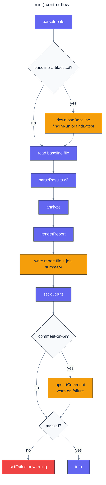

# Architecture

`llm-eval-action` is a JavaScript action (`runs.using: node24`). The runner executes the
committed bundle `dist/index.js`, which rollup builds from `src/`.

## Modules

| Module            | Responsibility                                                                                                                                   | Side effects  |
| ----------------- | ------------------------------------------------------------------------------------------------------------------------------------------------ | ------------- |
| `src/index.ts`    | Entry point: `run(defaultRuntime())`.                                                                                                            | yes           |
| `src/runtime.ts`  | Adapter over `@actions/core`, `@actions/github`, `@actions/artifact` and the file system. Implements the `Runtime` interface.                    | yes           |
| `src/main.ts`     | Orchestration: inputs, baseline resolution, analysis, report, outputs, optional comment, pass/fail. Talks to the outside only through `Runtime`. | via `Runtime` |
| `src/inputs.ts`   | Parses and validates action inputs into `ActionInputs` / `GateConfig`.                                                                           | none          |
| `src/parse.ts`    | Reads JSONL, JSON arrays, `{examples}` objects and evaluation-harness reports into `ResultSet` (a map from id to record).                        | none          |
| `src/align.ts`    | Shared ids, per-metric pairing by id, alignment summary.                                                                                         | none          |
| `src/stats.ts`    | Mean, SD, quantiles, paired bootstrap CI, paired t-test (incomplete beta), exact McNemar, Cohen's d_z.                                           | none          |
| `src/random.ts`   | Mulberry32 seeded generator.                                                                                                                     | none          |
| `src/analyze.ts`  | Per-metric verdicts, latency and cost summaries, budget checks, largest per-example regressions.                                                 | none          |
| `src/report.ts`   | Markdown report and the `deltas` JSON output.                                                                                                    | none          |
| `src/artifact.ts` | Locates and downloads the baseline artifact through an injected `ArtifactApi`.                                                                   | via API       |
| `src/comment.ts`  | Creates or updates the marked pull request comment through an injected `CommentApi`.                                                             | via API       |

## Control flow

Any thrown error (bad input, unreadable file, malformed record, missing metric) ends in
`setFailed` with the error message, so misconfiguration fails loudly instead of passing.

## Testing seams

`run` takes a `Runtime`, so the unit tests drive the whole flow with an in-memory fake
(captured outputs, summaries and failures) and real fixture files. `runtime.ts` is tested
with `vi.mock` stand-ins for the three `@actions/*` packages. The bundle itself is tested
end to end by `.github/workflows/test-action.yml`.

## Determinism

Ids are sorted with a locale-independent comparison before pairing, and the bootstrap uses
a seeded Mulberry32 generator, so a given pair of files and inputs always produces the
same report, byte for byte.
